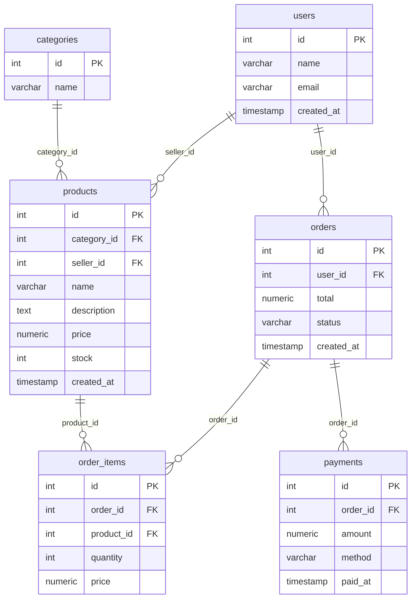

# RevoShop - Database Schema

Skema database PostgreSQL untuk toko online RevoShop (Checkpoint 1, Backend Development).

## Tabel
`users`, `categories`, `products`, `orders`, `order_items`, `payments`

## Setup lokal

1. Install PostgreSQL dan pastikan service berjalan.
2. Buat database:
   ```bash
   psql -U postgres -c "CREATE DATABASE revoshop;"
   ```
3. Jalankan file SQL berurutan:
   ```bash
   psql -U postgres -d revoshop -f schema.sql
   psql -U postgres -d revoshop -f seed.sql
   psql -U postgres -d revoshop -f queries.sql
   ```
4. Cek hasilnya:
   ```bash
   psql -U postgres -d revoshop -c "\dt"
   ```

`schema.sql` bisa dijalankan ulang kapan saja karena menghapus tabel lama terlebih dahulu.

## ERD


